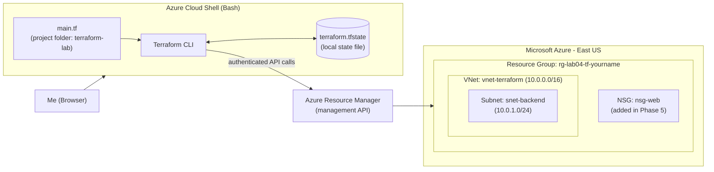
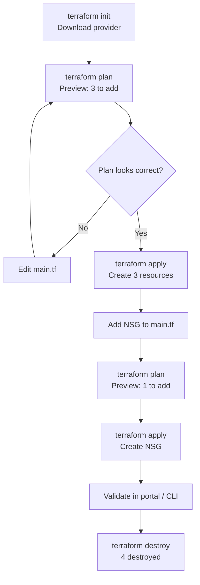

# Infrastructure as Code with Terraform


## [🎬 Watch Me Build This Lab!](https://streamable.com/kaof52)


---

## Table of Contents

1. [Overview](#1-overview)
2. [Architecture](#2-architecture)
3. [Prerequisites](#3-prerequisites)
4. [Lab Variables](#4-lab-variables)
5. [Step-by-Step Instructions](#5-step-by-step-instructions)
6. [Validation](#6-validation)
7. [Security Considerations](#7-security-considerations)
8. [Troubleshooting](#8-troubleshooting)
9. [Clean Up](#9-clean-up)
10. [Key Takeaways](#10-key-takeaways)

---

## 1. Overview

Clicking through the Azure Portal works, but it is slow, hard to repeat, and easy to get wrong. In this lab I define Azure infrastructure as **code** using **Terraform**, then create, change, and destroy it from the command line.

Everything runs inside **Azure Cloud Shell (Bash)**. There is nothing to install locally, and Cloud Shell is already authenticated to my Azure account.

**What this lab demonstrates**

- Writing infrastructure in declarative configuration files (HCL)
- The core Terraform workflow: `init`, `plan`, `apply`, `destroy`
- Reading a plan before approving it
- Changing existing infrastructure by editing code (adding an NSG)
- Tearing down everything cleanly, with an exact count of what was removed
- Why Terraform state needs to be protected

**Resources deployed**

| Phase | Resources | Plan result |
|-------|-----------|-------------|
| Initial deploy | Resource group, virtual network, subnet | `3 to add` |
| Modification | Network security group (`nsg-web`) | `1 to add` |
| Destroy | Everything above | `4 destroyed` |

---

## 2. Architecture

### 2.1 Where Everything Runs



### 2.2 Terraform Lifecycle Used in This Lab



### 2.3 Terraform Concepts at a Glance

| Concept | Role in this lab |
|---------|------------------|
| **Provider** (`azurerm`) | The plugin that translates Terraform code into Azure API calls |
| **Resource** | One piece of infrastructure (resource group, VNet, subnet, NSG) |
| **State** | Terraform's record of what it created. It is how `plan` knows what to add, change, or remove |
| **Plan** | A dry run showing exactly what Terraform *will* do |
| **Apply / Destroy** | Make the plan real, or remove what Terraform manages |

---

## 3. Prerequisites

- [ ] Active Azure subscription
- [ ] Access to [Azure Cloud Shell](https://portal.azure.com) (the `>_` icon in the portal's top bar)
- [ ] Permission to create resources in the subscription (Contributor or higher)
- [ ] Basic comfort with a Linux shell and a text editor (`nano` or the Cloud Shell editor)

---

## 4. Lab Variables

| Item | Value |
|------|-------|
| Project folder | `terraform-lab` |
| Resource group | `rg-lab04-tf-[yourname]` |
| Region | `East US` |
| Virtual network | `vnet-terraform` (`10.0.0.0/16`) |
| Subnet | `snet-backend` (`10.0.1.0/24`) |
| NSG (Phase 5) | `nsg-web` |

The code uses a variable, `name_suffix`, so you only change your name in one place.

---

## 5. Step-by-Step Instructions

### Phase 1: Open Cloud Shell and Prepare the Workspace

1. Sign in to the [Azure Portal](https://portal.azure.com).
2. Click the **Cloud Shell** icon (`>_`) in the top bar and choose **Bash**. If prompted, let Azure create the Cloud Shell storage.
3. Confirm Terraform is available and you are on the right subscription:

   ```bash
   terraform version
   az account show --query "{name:name, id:id}" --output table
   ```

4. Tell the Azure provider which subscription to use (required by current `azurerm` provider versions):

   ```bash
   export ARM_SUBSCRIPTION_ID=$(az account show --query id --output tsv)
   ```

5. Create and enter the project folder:

   ```bash
   mkdir terraform-lab && cd terraform-lab
   ```

**Expected result:** Terraform prints its version, and you are inside `~/terraform-lab`.

### Phase 2: Write the Configuration

1. Create the file:

   ```bash
   nano main.tf
   ```

2. Paste the following (resource group, virtual network, and subnet):

   ```hcl
   terraform {
     required_providers {
       azurerm = {
         source  = "hashicorp/azurerm"
         version = "~> 4.0"
       }
     }
   }

   provider "azurerm" {
     features {}
   }

   variable "name_suffix" {
     description = "Your name or initials, used to keep resource names unique and identifiable"
     type        = string
     default     = "yourname"
   }

   variable "location" {
     description = "Azure region"
     type        = string
     default     = "eastus"
   }

   resource "azurerm_resource_group" "rg" {
     name     = "rg-lab04-tf-${var.name_suffix}"
     location = var.location
   }

   resource "azurerm_virtual_network" "vnet" {
     name                = "vnet-terraform"
     address_space       = ["10.0.0.0/16"]
     location            = azurerm_resource_group.rg.location
     resource_group_name = azurerm_resource_group.rg.name
   }

   resource "azurerm_subnet" "backend" {
     name                 = "snet-backend"
     resource_group_name  = azurerm_resource_group.rg.name
     virtual_network_name = azurerm_virtual_network.vnet.name
     address_prefixes     = ["10.0.1.0/24"]
   }
   ```

3. Save and exit (`Ctrl+O`, `Enter`, `Ctrl+X`).

> **Notice the references.** The VNet uses `azurerm_resource_group.rg.name` instead of a typed-in name. Terraform reads those references to build a dependency graph, so it knows to create the resource group first.

### Phase 3: Initialize, Plan, and Apply

1. **Initialize.** Downloads the Azure provider and prepares the folder:

   ```bash
   terraform init
   ```

   **Expected result:** `Terraform has been successfully initialized!`

2. **Format and validate** (catches typos before they reach Azure):

   ```bash
   terraform fmt
   terraform validate
   ```

   **Expected result:** `Success! The configuration is valid.`

3. **Plan.** A dry run that shows what will change:

   ```bash
   terraform plan -var "name_suffix=yourname"
   ```

   **Expected result:** `Plan: 3 to add, 0 to change, 0 to destroy.`

   Read the plan. Confirm the names, region, and address ranges are what you intended **before** moving on.

4. **Apply.** Creates the resources:

   ```bash
   terraform apply -var "name_suffix=yourname"
   ```

   Review the plan again and type `yes` when prompted.

   **Expected result:** `Apply complete! Resources: 3 added, 0 changed, 0 destroyed.`

### Phase 4: Verify in Azure

Check the result in the portal (**Resource groups > `rg-lab04-tf-[yourname]`**) or from Cloud Shell:

```bash
az network vnet show \
  --resource-group rg-lab04-tf-[yourname] \
  --name vnet-terraform \
  --query "{name:name, addressSpace:addressSpace.addressPrefixes, subnets:subnets[].name}" \
  --output json
```

**Expected result:** the VNet `vnet-terraform` with address space `10.0.0.0/16` and the subnet `snet-backend`.

### Phase 5: Change Infrastructure by Changing Code

Now add a network security group. Open `main.tf` and append:

```hcl
resource "azurerm_network_security_group" "web" {
  name                = "nsg-web"
  location            = azurerm_resource_group.rg.location
  resource_group_name = azurerm_resource_group.rg.name

  security_rule {
    name                       = "Allow-HTTP"
    priority                   = 100
    direction                  = "Inbound"
    access                     = "Allow"
    protocol                   = "Tcp"
    source_port_range          = "*"
    destination_port_range     = "80"
    source_address_prefix      = "*"
    destination_address_prefix = "*"
  }
}
```

Then plan and apply again:

```bash
terraform plan -var "name_suffix=yourname"
terraform apply -var "name_suffix=yourname"
```

**Expected result:** the plan reports `Plan: 1 to add, 0 to change, 0 to destroy.` Terraform compares your code to its state and creates **only the NSG**. The three existing resources are left alone. This is the declarative model in action.

> **Optional extension:** as written, `nsg-web` exists but is not attached to anything, so it does not filter traffic yet. To enforce it on the subnet, add an association (this adds one more resource):
>
> ```hcl
> resource "azurerm_subnet_network_security_group_association" "backend" {
>   subnet_id                 = azurerm_subnet.backend.id
>   network_security_group_id = azurerm_network_security_group.web.id
> }
> ```

### Phase 6: Destroy

```bash
terraform destroy -var "name_suffix=yourname"
```

Review the list of resources to be destroyed and type `yes`.

**Expected result:** `Destroy complete! Resources: 4 destroyed.` and the resource group is gone from the portal.

---

## 6. Validation

| # | Check | Expected result |
|---|-------|-----------------|
| 1 | `terraform version` in Cloud Shell | Version prints |
| 2 | `terraform init` | `successfully initialized` |
| 3 | `terraform validate` | `configuration is valid` |
| 4 | `terraform plan` (first run) | `3 to add` |
| 5 | `terraform apply` | `3 added` |
| 6 | Portal / `az network vnet show` | VNet and `snet-backend` exist |
| 7 | `terraform plan` (after adding NSG) | `1 to add`, nothing else changes |
| 8 | `terraform apply` | `1 added` |
| 9 | `terraform destroy` | `4 destroyed` |
| 10 | Portal | Resource group no longer exists |

### Evidence

Add screenshots to a `docs/images/` folder and update the paths below.

| Step | Screenshot |
|------|-----------|
| Cloud Shell and Terraform version | `` |
| `terraform init` success | `` |
| First plan (3 to add) | `` |
| Apply complete | `` |
| Resources in the portal | `` |
| Second plan (1 to add) | `` |
| Destroy complete (4 destroyed) | `` |

---

## 7. Security Considerations

| Topic | What to know |
|-------|--------------|
| **State files contain sensitive data** | `terraform.tfstate` can hold resource details and, in other projects, secrets in plain text. Never commit state files to Git. |
| **Protect your repo** | Use a `.gitignore` for `.terraform/`, `*.tfstate*`, and `*.tfvars` (see below). Commit `.terraform.lock.hcl`, which pins provider versions. |
| **Remote state for real work** | Local state is fine for a lab. For teams and production, use a remote backend such as an Azure Storage account with RBAC, encryption, and state locking. |
| **Plan review is a security control** | `terraform plan` is where you catch an open port, a public resource, or an unintended deletion. Treat it like a code review for infrastructure. |
| **Least privilege for the identity running Terraform** | Cloud Shell uses my own credentials, which may be broad. In automation, use a dedicated identity scoped to the resources it manages. |
| **No secrets in `.tf` files** | Do not hardcode passwords or keys in configuration. Use Key Vault, environment variables, or secret-aware pipelines. |
| **Reproducibility is a security benefit** | Infrastructure defined in code can be reviewed, versioned, audited, and rebuilt identically, which reduces configuration drift and one-off manual changes. |
| **Scan your code** | Static analysis tools such as Checkov or Trivy can flag risky settings in Terraform before deployment. |
| **Know what the NSG rule does** | `Allow-HTTP` from `*` allows port 80 from anywhere. That is appropriate for a public web tier, but not something to copy blindly onto other subnets. An NSG also does nothing until it is associated with a subnet or NIC. |
| **Pin the provider version** | `version = "~> 4.0"` keeps runs predictable and avoids surprise upgrades. |

### Recommended `.gitignore`

```gitignore
# Local Terraform directory and state
.terraform/
*.tfstate
*.tfstate.*
crash.log

# Variable files that may contain secrets
*.tfvars
*.tfvars.json
```

---

## 8. Troubleshooting

| Issue | Likely cause | Fix |
|-------|--------------|-----|
| **`terraform: command not found`** | Wrong Cloud Shell mode | Make sure you are in **Bash**. Terraform is preinstalled there. |
| **`subscription_id is a required provider property`** | Subscription not provided | Run `export ARM_SUBSCRIPTION_ID=$(az account show --query id --output tsv)` and retry. Repeat after a new Cloud Shell session. |
| **`Error: Unsupported argument` or `Invalid block`** | Typo or wrong syntax in `main.tf` | Run `terraform fmt` and `terraform validate`, and read the line number in the error. |
| **`No configuration files`** | Wrong directory | `cd ~/terraform-lab` and confirm `main.tf` is there with `ls`. |
| **`resource already exists`** | A previous run, or a manual portal change | Delete the leftover resource or resource group, then re-run. |
| **Plan wants to recreate something unexpectedly** | State and Azure disagree (for example, a manual portal change) | Read the plan carefully. Avoid editing Terraform-managed resources by hand. |
| **Provider download problems** | Interrupted init | Run `terraform init -upgrade`. |
| **Cloud Shell timed out** | Idle sessions expire | Reconnect and `cd terraform-lab`. Files in your Cloud Shell home persist, so re-export `ARM_SUBSCRIPTION_ID` and continue. |

---

## 9. Clean Up

1. From inside `terraform-lab`, run:

   ```bash
   terraform destroy -var "name_suffix=yourname"
   ```

2. Confirm the resource group `rg-lab04-tf-[yourname]` is gone in the portal.
3. **Cloud Shell storage:** Cloud Shell keeps your files in a small storage account of its own (typically in a resource group named like `cloud-shell-storage-...`). It is not part of this lab's Terraform and is **not** removed by `destroy`. Leave it if you will use Cloud Shell again.
4. If you want a clean slate locally, remove the project folder: `cd ~ && rm -rf terraform-lab`. This also removes the state file.

---

## 10. Key Takeaways

- Infrastructure as Code turns clicks into reviewable, repeatable, version-controlled text.
- The `plan` step is the safety net. Read it every time, and do not approve changes you do not understand.
- Terraform is declarative: I describe the end state, and it works out the difference. Adding the NSG touched exactly one resource.
- State is the source of truth for Terraform and must be protected like any other sensitive file.
- Destroying is as important as creating. A precise "4 destroyed" confirms nothing was left running or billing.

---

## Repository Structure

```text
.
├── README.md
├── main.tf
├── .gitignore
└── docs/
    └── images/
```
